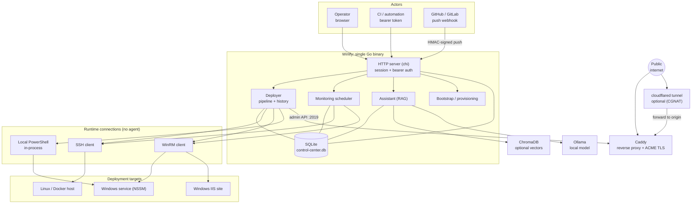
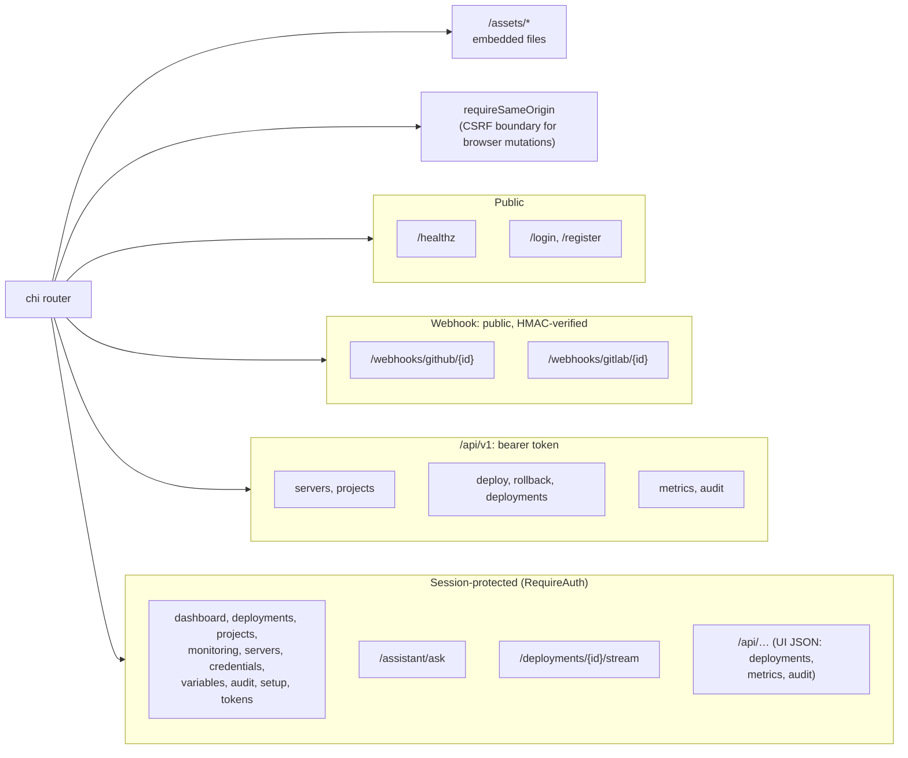
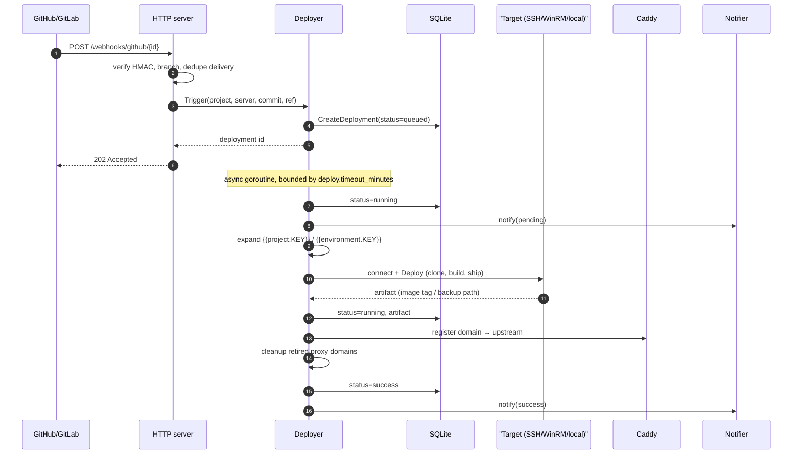
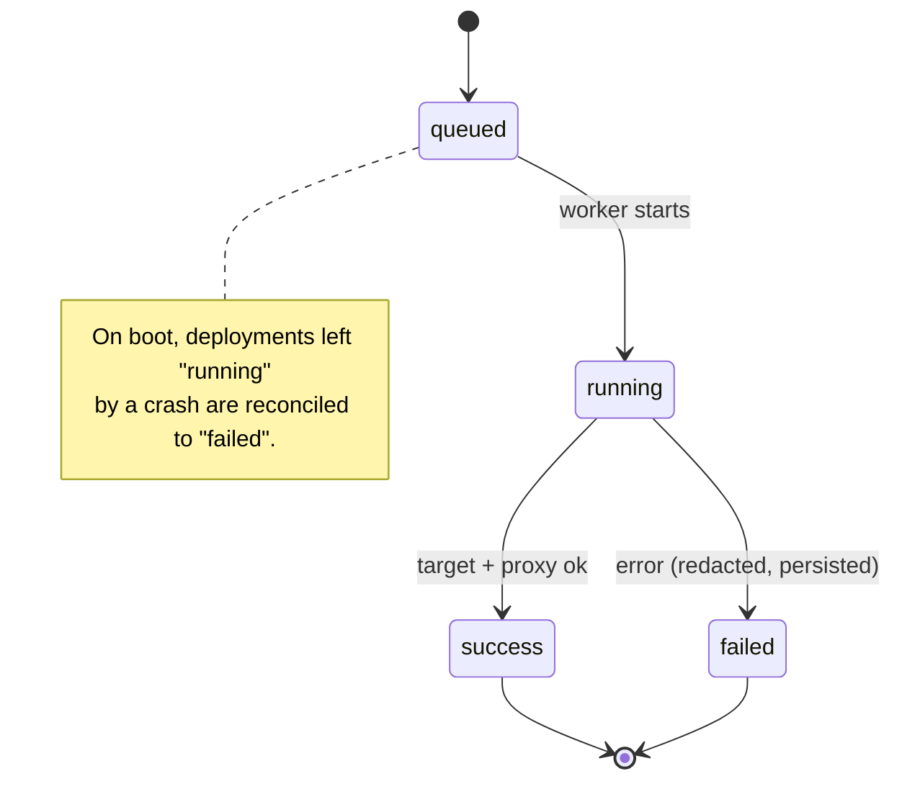
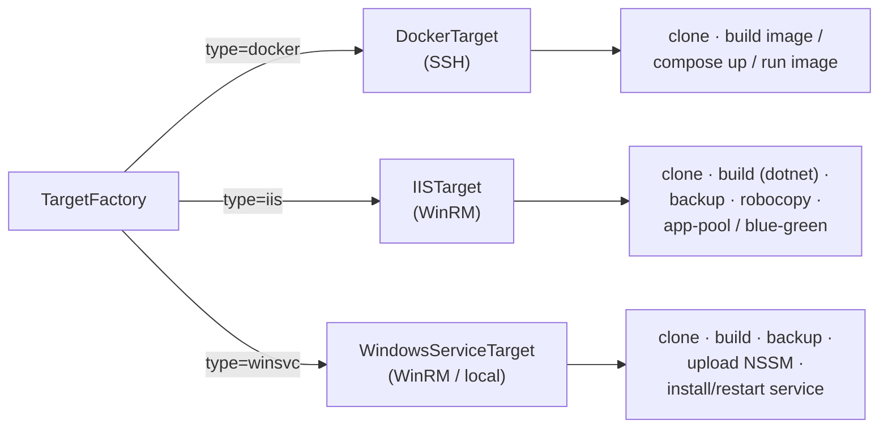
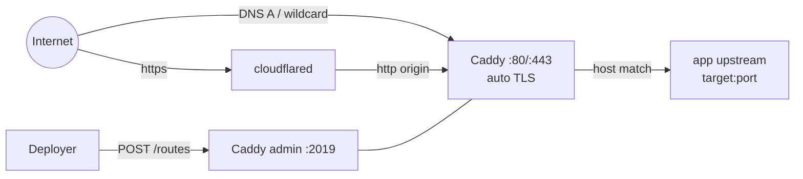
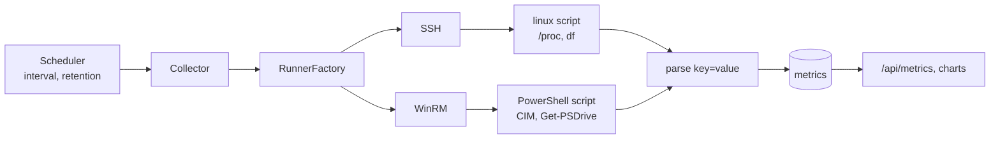
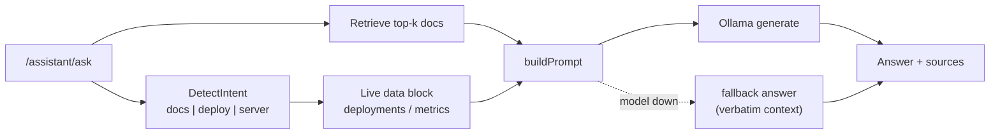
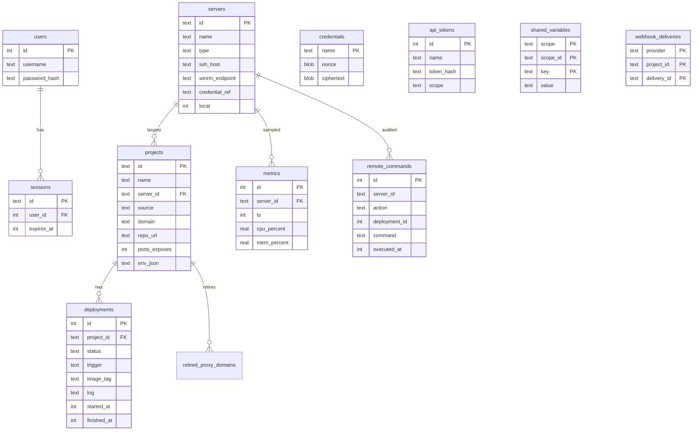
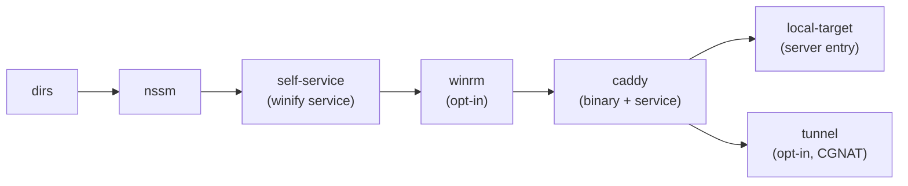

# System Design: Winify

A self-hosted deployment platform that owns the deployment lifecycle for
environments that mix **Windows/IIS** and **Linux/Docker**. One operator, one Go
binary, one SQLite file. It connects directly to target servers (SSH for
Docker/Linux, WinRM for Windows), builds and deploys applications, fronts each
deployment with a reverse proxy and automatic TLS, and polls metrics over the
same connections. It is not a dashboard that watches an external CI system.

---

## Contents

1. [Design goals and constraints](#1-design-goals-and-constraints)
2. [Context diagram](#2-context-diagram)
3. [Runtime components](#3-runtime-components)
4. [HTTP surface and auth boundaries](#4-http-surface-and-auth-boundaries)
5. [Deployment lifecycle](#5-deployment-lifecycle)
6. [Target pipelines](#6-target-pipelines)
7. [Reverse proxy, TLS and tunnel](#7-reverse-proxy-tls-and-tunnel)
8. [Monitoring](#8-monitoring)
9. [Assistant (local RAG)](#9-assistant-local-rag)
10. [Data model](#10-data-model)
11. [Security model](#11-security-model)
12. [Concurrency, lifecycle and shutdown](#12-concurrency-lifecycle-and-shutdown)
13. [Host bootstrap / provisioning](#13-host-bootstrap--provisioning)
14. [Configuration surface](#14-configuration-surface)
15. [Repository layout](#15-repository-layout)
16. [Key design decisions](#16-key-design-decisions)
17. [Deferred to v2](#17-deferred-to-v2)

---

## 1. Design goals and constraints

| Goal | Consequence in the design |
|---|---|
| Own the lifecycle end-to-end | The binary clones, builds and deploys; CI is an optional hook, not the core. |
| Windows/IIS is first-class | A dedicated WinRM runner and NSSM/IIS pipelines, not an afterthought. |
| Single admin, self-hosted | One user, session auth, SQLite, no multi-tenant isolation in v1. |
| Dependency-light | Go standard library first; SQLite, chi, one SSH and one WinRM library. |
| Honest state | Every deploy attempt is persisted; interrupted runs are reconciled on boot. |
| Credentials never leak | Secrets are AES-256-GCM encrypted at rest and resolved only at connect time. |

Non-goals (v1): multi-server orchestration, one-click service catalog, RBAC,
off-site backups. See [§17](#17-deferred-to-v2).

---

## 2. Context diagram



Winify is the only component that holds credentials. Targets receive
commands, never secrets; the reverse proxy receives only `host → upstream` route
registrations.

---

## 3. Runtime components

All components live in one process, wired in `cmd/control-center/main.go`.

| Component | Package | Responsibility |
|---|---|---|
| Entrypoint | `cmd/control-center` | `serve`, `bootstrap`, `hash-password`, `cred` subcommands; dependency wiring; graceful shutdown. |
| Config | `internal/config` | YAML + `CC_*` env loading, validation, inventory (`servers.yaml`, `projects.yaml`). Holds credential **refs**, never plaintext. |
| HTTP | `internal/server` | chi router, middleware, HTML rendering, REST API, SSE deploy stream, webhook receiver. |
| Auth | `internal/auth` | bcrypt admin login, session store, API tokens, AES-256-GCM credential store. |
| Models | `internal/models` | SQLite access layer and embedded SQL migrations. |
| Deployment | `internal/deployment` | Deployer, runner abstraction (SSH/WinRM/local), Docker, IIS and Windows-service pipelines, audit, repo detection. |
| Proxy | `internal/proxy` | Caddy admin-API client: register/deregister host routes with automatic HTTPS. |
| Monitoring | `internal/monitoring` | Agentless metric scheduler + collectors over the existing runners. |
| Assistant | `internal/assistant` | Local RAG over embedded docs plus live deploy/monitoring data (Chroma + Ollama). |
| Bootstrap | `internal/bootstrap` | Idempotent host provisioning (dirs, NSSM, self-service, WinRM, Caddy, tunnel). |
| Tunnel | `internal/tunnel` | Cloudflare tunnel + DNS provisioning for hosts behind CGNAT. |
| Notify | `internal/notify` | Outbound deploy events: generic webhook, Slack, GitHub commit statuses. |
| GitHub App | `internal/githubapp` | Installation tokens + push-hook registration. |
| Detect | `internal/detect` | Repo language/framework detection and build/run plan. |
| Service | `internal/service` | Windows service host + UAC self-elevation. |
| Static | `internal/static` | `go:embed` templates and web assets (fingerprinted URLs). |

---

## 4. HTTP surface and auth boundaries



| Boundary | Mechanism | Notes |
|---|---|---|
| Browser UI | `cc_session` cookie | bcrypt login, `SameSite=Lax`, optional `Secure`, TTL from config. |
| Browser mutations | `requireSameOrigin` | Rejects cookie-authenticated non-GET without same-origin `Origin`/`Referer`. Accepts forwarded host and configured public URL. |
| REST API | `Authorization: Bearer <token>` | Tokens stored as hashes; scope `read` or `write`. `write` is admin-equivalent. |
| Webhooks | HMAC / token | GitHub `X-Hub-Signature-256`; GitLab `X-Gitlab-Token`. Branch-filtered and de-duplicated by delivery id. |
| First-run | one-time setup token | Printed to the startup log when no admin exists and no token is configured. |

Webhook outcomes: `401` invalid signature, `202` accepted or ignored
(non-push / branch mismatch / duplicate delivery), `409` deploy already running.

---

## 5. Deployment lifecycle



The browser watches progress over Server-Sent Events
(`GET /deployments/{id}/stream`, `event: status` / `event: log`). Status writes
and logs use a **cancellation-proof context** so a timed-out deploy is still
finalized in history.

### Deploy states



Rollback reuses the same pipeline: Docker re-deploys the previous known-good
image tag; IIS/Windows-service restore the latest timestamped backup discovered
on the target. An in-flight guard (`sync.Map` keyed by project id) returns
`ErrDeployInProgress` for a second concurrent deploy of the same project.

---

## 6. Target pipelines

A single branch point, `NewTargetFactory`, selects the pipeline from
`server.Type`. Everything downstream of a `Target` is target-specific by design.



| Pipeline | Source options | Rollback artifact |
|---|---|---|
| **Docker** (`docker.go`) | `dockerfile`, `compose`, `image` | Previous image tag |
| **IIS** (`iis.go`) | Repo build + robocopy to site | Timestamped backup; optional blue-green slot swap |
| **Windows service** (`winservice.go`) | Repo build → NSSM service | Timestamped backup + service restart |

Connection selection (`NewRunnerFactory`, `target.go`):

| Server type | Transport |
|---|---|
| `docker` | SSH (`golang.org/x/crypto/ssh`), known-hosts verified by default |
| `iis`, `winsvc` (remote) | WinRM (`github.com/masterzen/winrm`), NTLM/basic |
| `winsvc` (local) | In-process PowerShell (no credential) |

Every runner is wrapped by an **audit recorder**, which persists each remote
command (server, action, deployment, redacted text) to `remote_commands`.

---

## 7. Reverse proxy, TLS and tunnel

Caddy is driven through its **admin API** (`127.0.0.1:2019`), not a config file.

- Each app gets a route with `@id = "cc-route-" + sha256(host)[:24]`, so
  redeploying replaces the route instead of duplicating it.
- Route = `host` matcher → `reverse_proxy` to `upstream` (`host:port`).
- Automatic HTTPS issues and renews certificates; `automatic_https.skip` covers
  hosts that cannot pass ACME, the shared `*.sslip.io` zone and any
  tunnel-fronted apex domain (e.g. `*.example.com`).
- Registration is **compensated**: the previous route is snapshotted and restored
  if the replacement is rejected, so a project does not go offline on failure.



For hosts that cannot accept inbound connections (CGNAT, private link), the
**tunnel** module provisions a Cloudflare tunnel once: it creates the tunnel,
sets ingress (`*.domain → http://localhost:80`), creates the wildcard DNS
record, and installs `cloudflared` as an NSSM service (`winify-tunnel`).
Per-deploy, winify still only registers routes in Caddy, no provider call.

---

## 8. Monitoring

Agentless: metrics are pulled over the **same** SSH/WinRM runners used for
deploys.



- One native script per OS prints `key=value` lines (CPU, memory, disk, uptime,
  load, service state); parsing is shared.
- Samples are persisted with a retention window and a per-server history cap for
  charts.
- An unreachable target records `reachable=0` with the connection error rather
  than serving stale numbers.

---

## 9. Assistant (local RAG)

Deliberately local and offline: **ChromaDB** (vector store) + **Ollama** (model).
If Chroma is unreachable, retrieval falls back to an in-process memory store; if
the model is unavailable, a deterministic grounded answer is returned.



The answer carries its **sources** (doc titles and live-data references), which
the UI renders so a claim can be traced.

---

## 10. Data model

SQLite, migrated by ordered embedded SQL files (`internal/models/migrations`).
Credentials are the only table holding secrets, and only as ciphertext.



Supporting tables: `app_meta` (schema/meta), `retired_proxy_domains` (deferred
route cleanup), `webhook_deliveries` (idempotency). The database is authoritative
after first run; `servers.yaml` / `projects.yaml` are imported only when empty.

---

## 11. Security model

This module category can run arbitrary commands on remote servers, so the
boundaries are explicit.

| Concern | Control |
|---|---|
| Secrets at rest | AES-256-GCM; the credential **name is the AEAD additional data**, so ciphertext cannot be moved between names. `master.key` is `0600`, symlink-rejected. |
| Secret in transit | Decrypted only in memory at connect time; never logged or returned to the browser/API. |
| Admin login | bcrypt; sessions in SQLite with expiry; `cc_session` cookie. |
| CSRF | `requireSameOrigin` on cookie-authenticated mutations. |
| API tokens | Random, stored as hashes; scoped `read`/`write`; `write` is admin-equivalent. |
| Remote command safety | IDs/paths validated; POSIX/PS quoting helpers; command output capped and **redacted** before it reaches logs/audit. |
| SSH trust | `known_hosts` verification on by default; insecure mode is an explicit opt-in. |
| Host key / TLS | Caddy admin bound to loopback; ACME for real domains; tunnel-fronted and sslip.io hosts intentionally HTTP-behind-terminator. |
| Destructive paths | Windows live-directory copies bounded by `deploy.target_root` unless `allow_external_target_paths`. |
| Response headers | `X-Content-Type-Options`, `X-Frame-Options: DENY`, `Referrer-Policy`, `Permissions-Policy`, `Cache-Control: no-store`. |

---

## 12. Concurrency, lifecycle and shutdown

- **Deployer**: each `Trigger`/`Rollback` records a row, then spawns a goroutine
  bounded by `context.WithTimeout(deploy.timeout_minutes)`. A `sync.WaitGroup`
  tracks workers; `Stop()` cancels the lifecycle context and waits (hard cap 30s)
  before the database closes.
- **In-flight guard**: `sync.Map` per project prevents concurrent deploys;
  cleared on completion, including failure paths.
- **Boot reconciliation**: sessions are pruned, deployments left `running` by a
  crash are marked `failed`, and history is pruned by retention. This is how the
  UI keeps "honest state" across restarts.
- **Monitoring**: its own scheduler goroutine, started/stopped with the process.
- **HTTP server**: bounded read/header/idle timeouts; graceful `Shutdown` on
  SIGINT/SIGTERM or service stop.
- **SSE**: the logger middleware forwards `Flush()` so the deploy stream is not
  buffered.

---

## 13. Host bootstrap / provisioning

Idempotent, step-based, and resumable. Each step has `Check` + `Apply`; state is
recorded so a partial run continues rather than repeating.



- Runs elevated; a fresh non-elevated start relaunches itself via UAC
  (`service.RelaunchElevated`) so the Windows service can be installed.
- Install root: `C:\ProgramData\winify` (Windows) or `/var/lib/winify` elsewhere.
- Services managed by Windows SCM: `winify` (the app), `winify-caddy`,
  `winify-tunnel`.
- The same step engine provisions a **remote** Windows target over WinRM
  (directories, NSSM, Caddy) and stores its credential encrypted.

---

## 14. Configuration surface

`config.yaml` (optional; built-in defaults) layered with `CC_*` environment
variables. Grouped as: `server`, `database`, `auth`, `credentials`, `files`,
`proxy`, `tunnel`, `deploy`, `bootstrap`, `monitoring`, `assistant`, `github`,
`notifications`.

Credential references are named, not inline: `vault:<name>` resolves from the
encrypted store at connection time, so inventory files never contain secrets.

---

## 15. Repository layout

```
control-center/
├── cmd/control-center/          # main entrypoint (serve, bootstrap, cred, hash-password)
├── internal/
│   ├── config/                  # YAML/env config + inventory
│   ├── server/                  # HTTP, routing, middleware, API, SSE
│   ├── deployment/              # deployer, runners (SSH/WinRM/local), docker/iis/winsvc
│   ├── proxy/                   # Caddy admin-API client
│   ├── monitoring/              # agentless metric scheduler + collectors
│   ├── assistant/               # ChromaDB + Ollama RAG
│   ├── bootstrap/               # host provisioning steps
│   ├── tunnel/                  # Cloudflare tunnel + DNS
│   ├── notify/                  # webhook / Slack / GitHub status sinks
│   ├── githubapp/               # GitHub App tokens + hook registration
│   ├── detect/                  # repo language/framework detection
│   ├── auth/                    # sessions, API tokens, credential encryption
│   ├── models/                  # SQLite access + embedded migrations
│   ├── service/                 # Windows service + elevation
│   └── static/                  # embedded templates, CSS, JS, assets
├── docs/
├── projects.yaml · servers.yaml
└── config.yaml
```

---

## 16. Key design decisions

| Decision | Rationale | Trade-off |
|---|---|---|
| One binary, one process | Trivial to self-host; no queue, broker or scheduler to run. | No horizontal scale; a single node owns all deploys. |
| SQLite | Zero-dependency persistence; easy backup. | Single-writer; not for concurrent multi-node. |
| Runner abstraction | SSH/WinRM/local differ only at the edges; pipelines, monitoring and detection share it. | Lowest-common-denominator command interface. |
| Caddy admin API | Dynamic per-deploy routes + automatic TLS without editing config. | Depends on Caddy's admin API contract. |
| `Target` interface | Docker/IIS/Windows-service are isolated; the Deployer stays target-agnostic. | Some duplication across pipelines. |
| AES-GCM with name-as-AAD | Prevents ciphertext swapping between credential names. | Renaming a credential requires re-encryption. |
| Local-only assistant | No cloud LLM; docs + live data are the grounding. | Answer quality bounded by the local model. |
| Compensation over rollback | Snapshots + restore routes/releases on failure. | More code paths to test. |

---

## 17. Deferred to v2

Multi-server orchestration / Docker Swarm · one-click service catalog ·
team / role-based access control · automated off-site backups.
