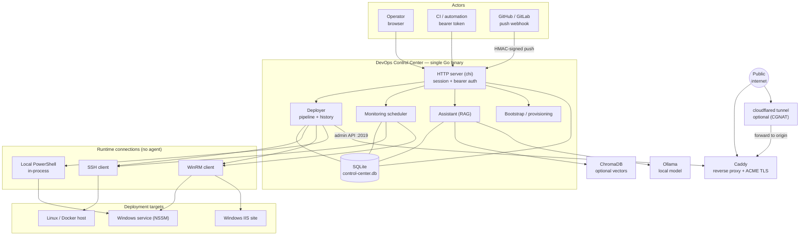
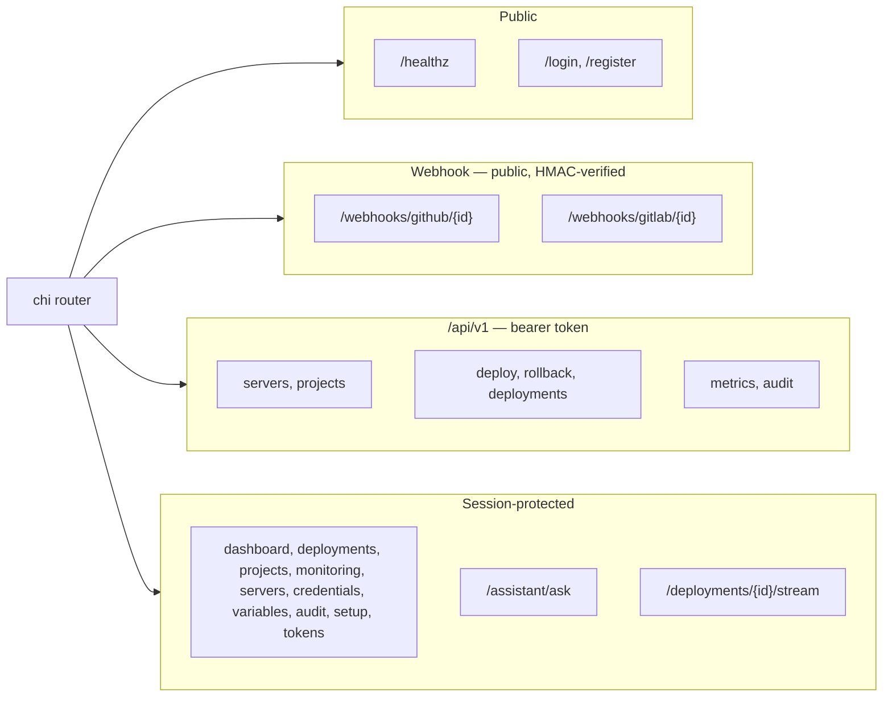

# Architecture

One operator, one Go binary, one SQLite file. winify connects directly to targets, builds and deploys, fronts each deployment with a reverse proxy and automatic TLS, and polls metrics over the same connections.

The control center is the only component that holds credentials. Targets receive commands, never secrets; the reverse proxy receives only `host → upstream` route registrations.

## Runtime components

| Component | Package | Responsibility |
| --------- | ------- | -------------- |
| Entrypoint | `cmd/control-center` | `serve`, `bootstrap`, `hash-password`, `cred`; wiring; graceful shutdown |
| Config | `internal/config` | YAML + `CC_*` env loading, validation, inventory |
| HTTP | `internal/server` | chi router, HTML, REST API, SSE deploy stream, webhooks |
| Auth | `internal/auth` | bcrypt login, sessions, API tokens, AES-256-GCM credential store |
| Models | `internal/models` | SQLite access + embedded SQL migrations |
| Deployment | `internal/deployment` | Deployer, SSH/WinRM/local runners, Docker/IIS/winsvc pipelines, audit |
| Proxy | `internal/proxy` | Caddy admin-API client |
| Monitoring | `internal/monitoring` | Agentless scheduler + collectors |
| Assistant | `internal/assistant` | ChromaDB + Ollama RAG over docs + live data |
| Bootstrap | `internal/bootstrap` | Idempotent host provisioning |
| Tunnel | `internal/tunnel` | Cloudflare tunnel + DNS for CGNAT |
| Notify | `internal/notify` | Webhook, Slack, GitHub commit statuses |
| GitHub App | `internal/githubapp` | Installation tokens + hook registration |
| Detect | `internal/detect` | Repo language/framework detection |
| Service | `internal/service` | Windows service host + UAC elevation |
| Static | `internal/static` | `go:embed` templates and web assets |

## Key decisions

| Decision | Rationale | Trade-off |
| -------- | --------- | --------- |
| One binary, one process | Trivial to self-host; no queue or broker | No horizontal scale |
| SQLite (pure-Go `modernc.org/sqlite`) | Zero-dep persistence; no C toolchain on Windows | Single-writer |
| Runner abstraction | SSH/WinRM/local differ only at edges; pipelines share it | Lowest-common-denominator commands |
| Caddy admin API | Dynamic per-deploy routes + auto TLS | Depends on Caddy admin contract |
| `Target` interface | Docker/IIS/winsvc isolated; Deployer stays agnostic | Some pipeline duplication |
| AES-GCM with name-as-AAD | Ciphertext cannot be moved between credential names | Rename requires re-encryption |
| Local-only assistant | No cloud LLM; grounded in docs + live data | Bounded by local model quality |
| Compensation over rollback | Snapshot + restore on failure | More code paths to test |

## HTTP surface and auth boundaries

| Boundary | Mechanism |
| -------- | --------- |
| Browser UI | `cc_session` cookie, bcrypt, `SameSite=Lax`, optional `Secure`, 12h TTL |
| Browser mutations | `requireSameOrigin` rejects cookie-authenticated non-GET without same-origin `Origin`/`Referer` |
| REST API | `Authorization: Bearer <token>`, scope `read` or `write` (`write` is admin-equivalent) |
| Webhooks | GitHub `X-Hub-Signature-256`; GitLab `X-Gitlab-Token`; branch-filtered, deduped by delivery id |
| First-run | One-time setup token printed to startup log |

See [Security](../security/hardening.md) and [REST API](../reference/api.md).
