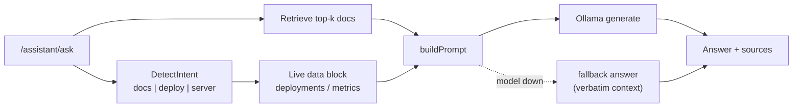

# Local assistant

Deliberately local and offline: **ChromaDB** (vector store) + **Ollama** (model). If Chroma is unreachable, retrieval falls back to an in-process memory store; if the model is unavailable, a deterministic grounded answer is returned.



- **Knowledge base**: these guides. The in-app subset (`internal/assistant/docs/*.md`) is generated from this site by `scripts/sync-assistant-docs.sh` — same content, chunked per `##` section for retrieval.
- **Intent routing**: `docs` | `deploy` | `server`. A named project/server plus a live keyword (`cpu`, `rollback`) routes to live data; `how do I…` routes to docs.
- **Grounding**: doc chunks + live deploy history and monitoring samples go into the prompt. The response includes `sources`, `intent`, `model`, `live`, `docs_used`, `latency_ms`, rendered in the UI so a claim can be traced.
- **Degradation**: stopping Ollama still returns a grounded answer from docs/live data instead of hanging. This is why the assistant works in demos without Ollama installed.

## Configuration

```yaml
assistant:
  enabled: true
  chroma_url: "http://127.0.0.1:8000"
  collection: "control-center-docs"
  ollama_url: "http://127.0.0.1:11434"
  model: "gemma3:1b"   # or "qwen3:1.7b"
  timeout_seconds: 60
  top_k: 3
```

To change the model, set `assistant.model` (or `CC_ASSISTANT_MODEL`) to any model pulled in Ollama. Smaller models are faster but follow instructions less reliably.
