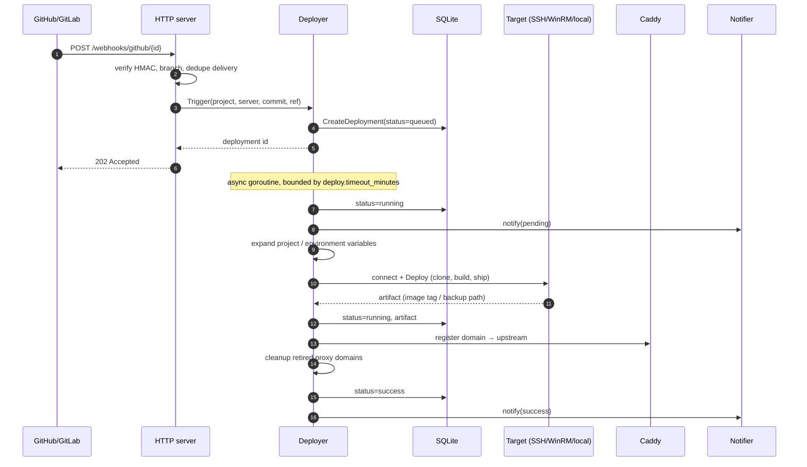
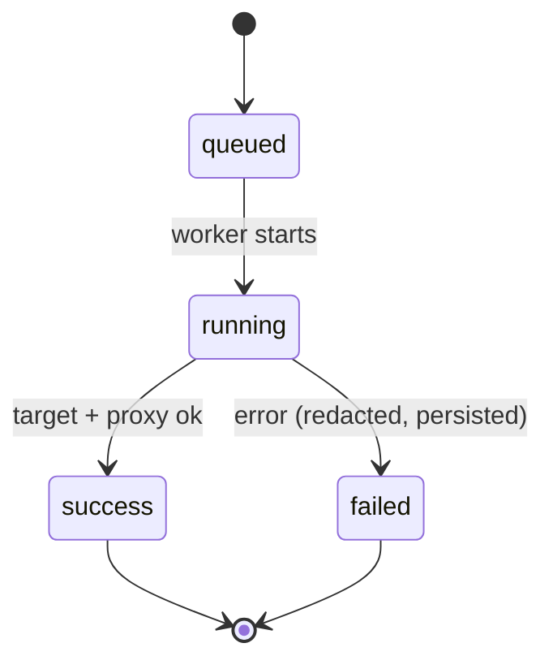

# Deployment lifecycle

The browser watches progress over Server-Sent Events (`GET /deployments/{id}/stream`, events `status` / `log`). Status writes and logs use a cancellation-proof context so a timed-out deploy is still finalized in history.

## Deploy states

- `trigger` is `manual` | `webhook` | `api` | `rollback`.
- Each `Trigger`/`Rollback` writes a row, then spawns a goroutine bounded by `context.WithTimeout(deploy.timeout_minutes)` (default 30). A `sync.WaitGroup` tracks workers; `Stop()` cancels and waits (hard cap 30s) before the database closes.
- An in-flight guard (`sync.Map` keyed by project id) returns `ErrDeployInProgress` for a second concurrent deploy of the same project — surfaced as `409`.
- On boot, sessions are pruned, deployments left `running` by a crash are marked `failed`, and history is pruned by `deploy.retention_days` (default 90). The UI never shows a stale `running`.

## Rollback

Rollback reuses the same pipeline with the previous known-good artifact. It creates a new history row (`trigger=rollback`), so the timeline stays honest. See [Deploy and roll back](../how-to/deploy-rollback.md).

## Variables

Before connecting, the Deployer expands `{{project.KEY}}` / `{{environment.KEY}}` from project env, shared variables, and build env. Secret values are redacted in logs and audit. See [Environment variables](../how-to/env-variables.md).
