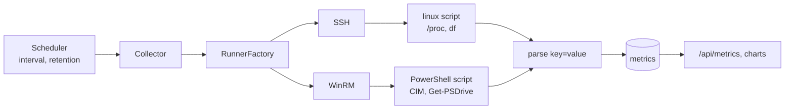

# Monitoring

Agentless: metrics are pulled over the **same** SSH/WinRM runners used for deploys.



- One native script per OS prints `key=value` lines (CPU, memory, disk, uptime, load, service state); parsing is shared.
- `cpu`, `mem_total`, `mem_used`, `disk_total`, `disk_used`, `uptime`, `load1`, plus per-service `service:<name>=<state>`.
- Windows: `Get-Counter '\Processor(_Total)\% Processor Time'` (CIM fallback), `Win32_OperatingSystem`, `Win32_LogicalDisk`, `Get-Service` per watched service.
- Linux: `/proc/stat` (CPU delta), `/proc/meminfo`, `df -kP`, `/proc/uptime`, `/proc/loadavg`, `systemctl is-active` per service.
- Samples persist with a retention window (`monitoring.retention_hours`, default 24) and per-server history cap (`monitoring.history_points`, default 200) for charts.
- An unreachable target records `reachable=0` with the connection error rather than serving stale numbers. The dashboard shows a red `down` pill within `monitoring.timeout_seconds`.

## Configuration

```yaml
monitoring:
  enabled: true
  interval_seconds: 30
  timeout_seconds: 15
  retention_hours: 24
  history_points: 200
```

List services to watch in each server's `services` field (systemd units or Windows service names) and the volume in `disk_path` (`/` on Linux, `C:` on Windows).

Operational use: [Monitor servers](../how-to/monitoring.md). API: `GET /api/v1/metrics`, `GET /api/v1/servers/{id}/metrics`.
