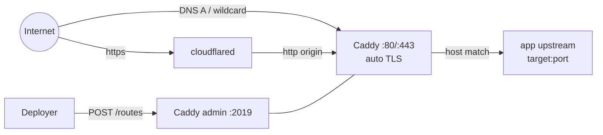

# Reverse proxy, TLS, and tunnel

Caddy is driven through its **admin API** (`127.0.0.1:2019`), not a config file.

- Each app gets a route with `@id = "cc-route-" + sha256(host)[:24]`, so redeploying replaces the route instead of duplicating it.
- Route = `host` matcher → `reverse_proxy` to `upstream` (`host:port`).
- Automatic HTTPS issues and renews certificates; `automatic_https.skip` covers hosts that cannot pass ACME, the shared `*.sslip.io` zone and any tunnel-fronted apex domain.
- Registration is **compensated**: the previous route is snapshotted and restored if the replacement is rejected, so a project does not go offline on failure.
- After registering, winify resolves the domain and warns if it does not point at the proxy host (`proxy.public_ip` is the expected address).
- Retired domains are tracked (`retired_proxy_domains`) and cleaned up after a domain change.
- If Caddy is unreachable at startup, winify warns (deploys with a domain will fail) instead of failing later.



## Configuration

```yaml
proxy:
  enabled: true
  admin_url: "http://127.0.0.1:2019"
  server_name: "srv0"
  public_ip: ""
  acme_skip:
    - "*.sslip.io"
```

- Keep `admin_url` on loopback or a protected management network. The Caddy admin API is unauthenticated, never publish port 2019 publicly.
- Set `enabled: false` only when there is no reverse proxy; deploys still run but register no public URL.
- Add a custom domain to `acme_skip` when it is fronted by a tunnel or external TLS terminator (e.g. Cloudflare Tunnel); otherwise Caddy redirects `:80` → `:443` and loops inside the tunnel.

## Tunnel (CGNAT solution)

For hosts that cannot accept inbound connections (CGNAT, private ISP link, laptop), the tunnel module provisions a Cloudflare tunnel **once**: it creates the tunnel, sets ingress (`*.domain → http://localhost:80`), creates the wildcard DNS record, and installs `cloudflared` as an NSSM service (`winify-tunnel`). Per-deploy, winify still only registers routes in Caddy, no provider call.

```yaml
tunnel:
  enabled: false
  provider: "cloudflare"
  domain: ""
  account_id: ""
  zone_id: ""
  tunnel_name: "winify"
  api_token_ref: "vault:cloudflare-api"
  origin: "http://localhost:80"
  connector_source: ""
  connector_url: ""
  connector_sha256: ""
  service_name: "winify-tunnel"
```

Full setup: [Tunnel for CGNAT](../how-to/tunnel-cgnat.md).

## DNS checklist

1. Real domain: `A` (or wildcard `*.example.com`) → Caddy host public IP. Ports 80/443 reachable from the internet for ACME.
2. Tunnel domain: wildcard CNAME `*.example.com` → `<tunnel-id>.cfargotunnel.com`, proxied. Created once by winify.
3. No-DNS yet: use `<name>.<ip>.sslip.io` via server `public_ip` (HTTP only, in `acme_skip`).
