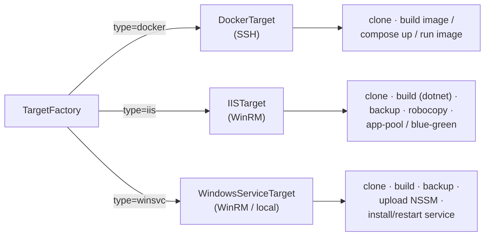

# Targets

One branch point, `NewTargetFactory`, selects the pipeline from `server.type`. Everything downstream of a `Target` is target-specific by design.

| Server type | Transport |
| ----------- | --------- |
| `docker` | SSH (`golang.org/x/crypto/ssh`), known-hosts verified by default |
| `iis`, `winsvc` (remote) | WinRM (`github.com/masterzen/winrm`), NTLM/basic |
| `winsvc` (local) | In-process PowerShell (no credential) |

Every runner is wrapped by an audit recorder persisting each remote command to `remote_commands`.

## winsvc: native Windows service (default, recommended)

A built executable run as a Windows service via **NSSM**.

1. `git clone/fetch` + checkout (`origin/*` branch resolution, `git clean -fdx`, `-c safe.directory` for LocalSystem vs user-owned clones).
2. Ensure build runtime (`python` / `node` / `go` / `dotnet`): installs if missing.
3. Optional build (`service_build_command`, e.g. `go build`, `dotnet publish`).
4. Ensure NSSM on target (chunked base64 upload from `deploy.nssm_source` if missing; SHA-256 verified).
5. Validate before touching live: NSSM present, source dir exists, service exe exists.
6. Stop service (no-op on first deploy).
7. Timestamped backup (`NO_BACKUP` on first deploy).
8. Deploy files (`robocopy /MIR`).
9. Install/update service (`nssm install` / `set Application/AppDirectory/AppParameters/AppEnvironmentExtra`).
10. Reset service env to empty when no env is configured, so removed secrets do not survive.
11. Start and wait for `Running` (30s deadline).
12. Optional per-target Caddy static serving; central Caddy still owns public TLS.
13. HTTP smoke test.
14. On any failure: restore backup + restart, mark `failed`.

**Rollback**: restore newest timestamped backup on target and restart.

## iis: IIS application (advanced/legacy)

Same shape plus IIS specifics. Zero-touch IIS: winify creates the app pool and site if missing.

Pipeline: clone → runtime → optional build → ensure site/app pool → validate (`web.config` XML + pool + optional service) → stop → backup → robocopy → start + recycle pool → smoke test.

**Blue-green** (`iis_blue_green: true`):

- Live directory is never overwritten. Build goes to the inactive slot (`<path>` / `<path>.blue`), validated there, then the site's `physicalPath` is repointed atomically and the pool recycled.
- Marker file (`<path>.active`) records the live slot.
- Rollback repoints to the other slot, no file copy, effectively instant.
- Failed swap/smoke test swaps back.

Use IIS only for ASP.NET Framework, Windows auth, classic ASP, or an existing IIS site. Prefer `winsvc` otherwise.

## docker: Linux target over SSH

| `source` | Behavior |
| -------- | -------- |
| `dockerfile` (default) | Clone → `docker build -t cc/<project>:<sha> -f <Dockerfile> --build-arg ...` → generated compose → `docker compose up -d --remove-orphans` → health check |
| `compose` | Clone → write `.env` from project env → `docker compose -f <compose> up -d --build --remove-orphans` → health check |
| `image` | Run prebuilt registry image via generated compose → health check |

**Port model**: `ports_exposes` is the in-container port; optional `ports_mappings` publish `host:container`. If no mapping, the exposed port is published 1:1. The proxy dials `EffectiveHostPort()`.

**Rollback**:

- `dockerfile`/`image`: re-run previous image tag, no rebuild.
- `compose`: check out previous commit and re-run its compose file.

On failure winify attempts to restore the previous successful release automatically when one exists.

## Health checks (shared)

- HTTP GET to `health_path` on `EffectiveHostPort()`.
- Timing from project (`health_interval_seconds`, `health_timeout_seconds`, `health_retries`, `health_start_period_seconds`) falling back to global `deploy.*`.
- `disable_health_check: true` for workers/cron with no HTTP endpoint.
- On Docker failure, `compose ps` + `compose logs` are dumped into the deploy log.

## Repo auto-detection

Inspect a repo and propose a build/run plan, Render/Railway style:

| Stack | Detection | Plan |
| ----- | --------- | ---- |
| Go | `go.mod` | `go build -o app.exe`, reads `go 1.x` |
| .NET | `.csproj` / `.sln` | `dotnet publish -c Release -o out`; `web.config` → IIS, else service |
| Python | `requirements.txt` / `pyproject.toml` / entry file | venv + pip; Django/FastAPI/Flask ports |
| Node | `package.json` | `npm ci` (+ build); Next.js / Vite / Express |
| Static | `index.html` | Per-target Caddy static on 8080 |

Each plan carries confidence (`high`/`medium`/`low`) and evidence (which files justified it).
