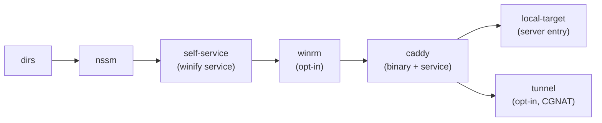

# Bootstrap hosts

Idempotent, step-based, resumable. Each step has `Check` + `Apply`; state in `app_meta` (`bootstrap.<step>`) so a partial run continues rather than repeating.



| Step | What it does | Probe |
| ---- | ------------ | ----- |
| `dirs` | Create `%ProgramData%\winify\{tools,work,apps,backups,logs,data}` (or `/var/lib/winify` on Linux) | `Test-Path` each dir |
| `nssm` | Ensure `tools\nssm.exe` from `deploy.nssm_source` or download + SHA-256 pin | Hash matches pin |
| `winrm` | `Enable-PSRemoting -Force` (only if `bootstrap.enable_winrm: true`; refuses public profiles) | Service + listener on 5985 |
| `self-service` | Install winify as native Windows service (`sc create`, auto-start, recovery) | `sc query winify` |
| `local-target` | Create local `winsvc` server (no credential, in-process) | Server `local` exists |
| `caddy` | Ensure `caddy.exe`, base config, NSSM Caddy service, open 80/443 | Service + config present |
| `firewall` | `New-NetFirewallRule` for 80/443 | Rule present |
| `tunnel` | Install cloudflared + provision ingress (when enabled) | Service + DNS present |

## Run it

```powershell
# Preview
.\winify.exe bootstrap --dry-run
# Apply (elevated)
.\winify.exe bootstrap
# Remote over WinRM
.\winify.exe bootstrap --remote http://host:5985/wsman --user 'DOMAIN\user'
```

Remote password via `CC_REMOTE_WINRM_PASSWORD` or an interactive prompt. Remote reuses the chunked binary upload built for NSSM. If WinRM is off on the remote, run the one-time `Enable-PSRemoting -Force` snippet there first (WMI/PsExec fallback is deferred).

On `serve` start (Windows, bootstrap incomplete):

- Running as a service (LocalSystem) → already elevated → runs in background.
- Interactive, not elevated → never silently UAC; the **Setup** page shows per-step status with **Run bootstrap** (launches elevated `winify bootstrap` via `Start-Process -Verb RunAs`) and live log.

## Config

```yaml
bootstrap:
  enabled: true
  install_dir: ""            # default %ProgramData%\winify (Windows)
  service_name: "winify"
  enable_winrm: false        # keep false unless on a trusted management network
  caddy:
    enabled: false
    source: ""               # local caddy.exe (wins over url)
    url: ""                  # release zip URL
    sha256: ""               # pinned hash of caddy.exe
    admin: "127.0.0.1:2019"
```

Binaries come from `deploy.nssm_source` / `bootstrap.caddy.{source,url}` with optional SHA-256 pins. Remote downloads without a pin are rejected by the installer script path.

## Security notes

- Privileged steps require elevation; every apply is audit-logged.
- Binary downloads are SHA-256 verified.
- Auto-enabling WinRM and creating services are logged and configurable.
- Prompted passwords go straight into the encrypted store, never the log.
